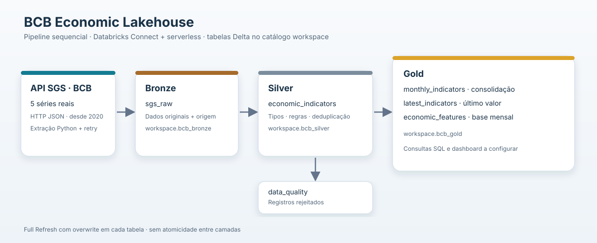
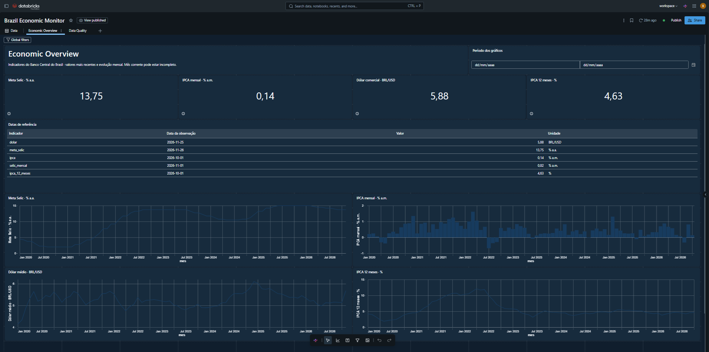
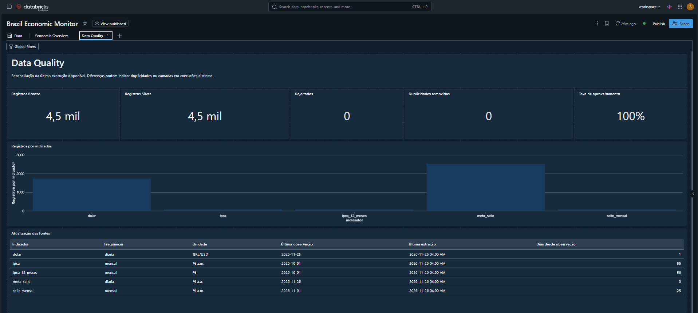

# BCB Economic Lakehouse

[](https://www.python.org/) [](https://docs.databricks.com/dev-tools/databricks-connect/python/) [](https://delta.io/) [](https://github.com/obrunojeronimo/bcb-economic-lakehouse)

Pipeline de engenharia de dados que coleta cinco séries reais do [Sistema Gerenciador de Séries Temporais (SGS) do Banco Central do Brasil](https://www.bcb.gov.br/estabilidadefinanceira/sgs), valida observações e publica seis tabelas Delta em um lakehouse Medallion no Databricks Free Edition. O código executa localmente com Databricks Connect e processa remotamente em compute serverless.

## Sumário

- [Arquitetura](#arquitetura)
- [Fontes e tecnologias](#fontes-e-tecnologias)
- [Estrutura](#estrutura)
- [Instalação e reprodução](#instalação-e-reprodução)
- [Qualidade de código](#qualidade-de-código)
- [Resultados observados](#resultados-observados)
- [Consultas e dashboard](#consultas-e-dashboard)
- [Histórico de versões](CHANGELOG.md)
- [Limitações](#limitações)
- [Licença](#licença)

## Arquitetura



| Camada | Tabelas no catálogo `workspace` | Função |
| --- | --- | --- |
| Bronze | `bcb_bronze.sgs_raw` | Resposta da API com valores e datas originais, metadados e horário de extração. |
| Silver | `bcb_silver.economic_indicators`, `bcb_silver.data_quality` | Conversão de tipos, rejeição de inválidos, detecção de conflitos e remoção de duplicidades. |
| Gold | `bcb_gold.monthly_indicators`, `bcb_gold.latest_indicators`, `bcb_gold.economic_features` | Consolidação mensal, última observação por série e base mensal de cinco indicadores. |

O processamento é **Full Refresh**: cada execução consulta o SGS desde `01/01/2020` até a data atual e sobrescreve as seis tabelas com `mode("overwrite")`. Cada escrita Delta é individual; **não existe garantia de atomicidade entre todas as camadas**. Se uma etapa falhar, parte das tabelas pode refletir execuções diferentes. Consulte [decisões de engenharia](docs/engineering_decisions.md) e [dicionário de dados](docs/data_dictionary.md).

## Fontes e tecnologias

| Série SGS | Nome no projeto | Frequência | Unidade |
| ---: | --- | --- | --- |
| [432](https://api.bcb.gov.br/dados/serie/bcdata.sgs.432/dados?formato=json) | `meta_selic` | diária | % a.a. |
| [433](https://api.bcb.gov.br/dados/serie/bcdata.sgs.433/dados?formato=json) | `ipca` | mensal | % a.m. |
| [1](https://api.bcb.gov.br/dados/serie/bcdata.sgs.1/dados?formato=json) | `dolar` | diária | BRL/USD |
| [4390](https://api.bcb.gov.br/dados/serie/bcdata.sgs.4390/dados?formato=json) | `selic_mensal` | mensal | % a.m. |
| [13522](https://api.bcb.gov.br/dados/serie/bcdata.sgs.13522/dados?formato=json) | `ipca_12_meses` | mensal | % |

Python, `requests` (retry HTTP), PySpark via `databricks-connect`, Delta Lake, Unity Catalog e `pytest`. As versões das dependências diretas estão fixadas em `requirements.txt`; as transitivas não têm lockfile e podem mudar entre instalações. Os resultados dependem da disponibilidade e de revisões dos dados públicos do SGS.

## Estrutura

```text
config/series.json          Séries e data inicial
src/extract.py              Coleta HTTP da API SGS
src/connection.py           Sessão Databricks Connect serverless
src/bronze.py               Ingestão Bronze
src/silver.py               Validação e Silver
src/gold.py                 Agregações Gold
src/pipeline.py             Orquestração sequencial e tempos
tests/test_extract.py       Testes unitários de configuração e extração
tests/test_pipeline.py      Testes de ordem e falha da orquestração
sql/                       Consultas analíticas e de qualidade
dashboards/                Definição AI/BI e implantação via SDK
docs/                      Arquitetura, dicionário, decisões e guias
requirements.txt            Dependências Python
CHANGELOG.md                Histórico da release
pytest.ini                  Descoberta de testes isolada do projeto pai
pyrightconfig.json          Resolução de imports e análise de tipos
```

## Instalação e reprodução

1. Tenha Python compatível com `databricks-connect==19.1`, Git, acesso à internet e um workspace Databricks Free Edition com compute serverless e permissão para criar esquemas e tabelas no catálogo `workspace`. Confirme a compatibilidade da versão do Python com o runtime do workspace antes de instalar. Os testes locais deste repositório foram executados com Python 3.12.
2. Clone o repositório e crie um ambiente virtual:

   ```powershell
   git clone https://github.com/obrunojeronimo/bcb-economic-lakehouse.git
   cd bcb-economic-lakehouse
   py -3.12 -m venv .venv
   .\.venv\Scripts\Activate.ps1
   python -m pip install -r requirements.txt
   ```

   Em macOS/Linux, use `python3.12 -m venv .venv` e `source .venv/bin/activate`.
3. Instale a [Databricks CLI](https://docs.databricks.com/dev-tools/cli/install.html) e autentique **o workspace desejado** no perfil local `DEFAULT`, exigido por `src/connection.py`:

   ```powershell
   databricks auth login --host https://<seu-workspace> --profile DEFAULT
   databricks auth describe --profile DEFAULT
   ```

   A configuração de autenticação fica no computador do usuário, fora do repositório. Não inclua tokens em comandos, arquivos versionados ou capturas de tela. Se já existir outro perfil `DEFAULT`, avalie seu workspace antes de substituí-lo. O código atual usa esse nome de perfil fixo; para outro nome seria necessária uma alteração explícita de código.
4. Verifique a conexão e rode os testes locais:

   ```powershell
   python -m src.connection
   python -m pytest -q
   ```

5. Execute o pipeline completo:

   ```powershell
   python -m src.pipeline
   ```

   A execução cria os esquemas `workspace.bcb_bronze`, `workspace.bcb_silver` e `workspace.bcb_gold`, além das seis tabelas. Reexecutar substitui os dados existentes. A API é pública e não precisa de credencial própria. O endpoint pode limitar requisições ou estar indisponível; `src/extract.py` aplica até três tentativas adicionais para os códigos HTTP configurados e timeout de 60 segundos por chamada.
6. No editor SQL do Databricks, selecione um SQL warehouse com acesso ao catálogo `workspace` e execute, por consulta, `sql/economic_indicators.sql` e `sql/data_quality.sql`. As consultas de validação ajudam a conferir a execução atual; as contagens históricas abaixo não são garantidas em nova execução.

Os quatro testes em `tests/test_extract.py` usam resposta HTTP simulada. Eles verificam configuração, resposta válida, resposta vazia e preservação de valor negativo. Os dois testes em `tests/test_pipeline.py` verificam a ordem Bronze → Silver → Gold e a liberação da sessão em caso de falha. **Não são testes de integração** com o SGS ou com o Databricks. Executar o pipeline é a verificação de integração operacional. `pytest.ini` e `pyrightconfig.json` resolvem importações a partir da raiz deste repositório; a execução não depende de configurações da pasta `databricks-lab`. Para executar uma camada isoladamente, use `python -m src.bronze`, `python -m src.silver` ou `python -m src.gold` a partir da raiz.

## Qualidade de código

Para conferir a release no ambiente virtual do projeto, instale Pylint, Ruff e Pyright como ferramentas de desenvolvimento e execute:

```powershell
python -m pylint src tests dashboards --persistent=n
python -m ruff check src tests --select E,F,I
python -m ruff format --check src tests
python -m pyright
python -m pytest -q
```

Essas ferramentas não são dependências de execução em `requirements.txt`. O diretório `Microsoft/` presente em algumas instalações é um cache de análise de módulos do PowerShell; ele e os demais caches locais são ignorados pelo Git.

## Resultados observados

Execução informada e validada em **26/11/2026**, no Databricks Free Edition:

| Métrica | Resultado |
| --- | ---: |
| Séries | 5 |
| Registros Bronze / Silver válidos | 4.500 / 4.500 |
| Rejeitados / duplicidades removidas | 0 / 0 |
| Aproveitamento nas regras implementadas | 100% |
| `monthly_indicators` / `latest_indicators` / `economic_features` | 413 / 5 / 83 |
| Testes automatizados aprovados na revisão v1.0.0 | 6 |
| Bronze / Silver / Gold | 6,53 s / 8,89 s / 9,85 s |
| Tempo total | 26,96 s |

Detalhes e escopo das medições: [relatório de execução](docs/execution_report.md).

## Consultas e dashboard

As consultas Gold estão em [indicadores econômicos](sql/economic_indicators.sql); verificações sobre as seis tabelas estão em [qualidade de dados](sql/data_quality.sql). O dashboard **Brazil Economic Monitor** possui duas páginas: **Economic Overview** e **Data Quality**. A definição exportável está em [brazil_economic_monitor.lvdash.json](dashboards/brazil_economic_monitor.lvdash.json). Para validá-lo e implantá-lo no perfil `DEFAULT`, execute `python -m dashboards.deploy_dashboard`; o script usa um SQL Warehouse serverless `2X-Small` já existente, valida as 15 consultas dos arquivos SQL e os nove datasets do dashboard e cria ou atualiza um rascunho. Use `--validate-only` para executar apenas a validação. Consulte o [guia de implantação](docs/dashboard_setup.md) para requisitos e limitações. A URL é impressa ao final; identificadores do workspace não são armazenados no repositório.


## Dashboard - Brazil Economic Monitor

Dashboard desenvolvido nativamente no Databricks AI/BI,
consumindo as tabelas da arquitetura Medalhão.

### Economic Overview

Acompanhamento dos principais indicadores macroeconômicos
brasileiros, incluindo Selic, IPCA e câmbio.



### Data Quality

Monitoramento da qualidade, volumetria, integridade
e atualização dos dados processados pelo pipeline.



## Limitações

- A atualização é Full Refresh com sobrescrita e requer acesso à API e ao Databricks; o custo e a latência crescem com o histórico.
- Escritas em tabelas distintas não formam transação única. Uma falha pode deixar Bronze, Silver e Gold em estados de execuções diferentes.
- `monthly_indicators` usa média aritmética das observações e `economic_features` usa o último valor para séries de taxa. **O mês corrente pode conter valores mensais incompletos** ou ainda não publicados; não interprete lacunas como zero.
- A qualidade implementada valida tipo, ausência de campos essenciais, conflito de valor por série/data e duplicidade. Ela não cobre plausibilidade econômica, continuidade temporal ou reconciliação com outra fonte.
- Testes unitários de extração não comprovam conectividade com SGS, permissões no Unity Catalog ou execução integral das camadas.
- Os tempos e volumes refletem uma execução específica e podem mudar por atualização da fonte, região, rede e carga do compute.

## Licença

O código e a documentação deste projeto são disponibilizados sob a [licença MIT](LICENSE). Os dados públicos obtidos de fontes de terceiros, incluindo as séries da API SGS do Banco Central do Brasil, permanecem sujeitos às condições de uso de suas respectivas fontes; a licença deste repositório não altera essas condições.
